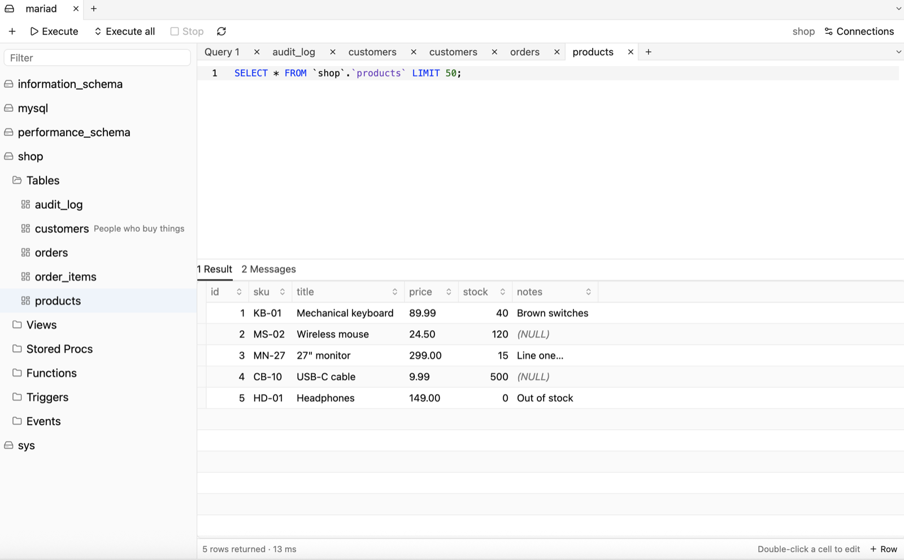

# OpenViSQL

A fast, native desktop SQL client written in Rust, for macOS and Windows.

OpenViSQL connects to **MySQL**, **MariaDB** and **SQLite** today; **PostgreSQL** is next.
The layout is the classic one for MySQL tools: an object browser on the left, query tabs on
the right, and results below.



## Features

- **SQLite** database files, opened or created from the connection manager. They get the same
  editor, grid editing, export, CSV import, backup/restore and table designer (which rebuilds
  the table safely). Server-only tools are hidden for them.
- Several connections open at once as tabs across the top, with tabs that shrink to fit. The
  app starts on the connection manager with nothing connected. Each connection's query tabs
  (titles, SQL, database) come back when you connect to it again.
- Saved passwords are never in plain text. Each connection chooses where its password goes:
  - the OS keychain (macOS Keychain or Windows Credential Manager), or
  - an encrypted file on this computer, which never shows a system prompt.
- TLS (encrypt-only or full certificate verification), compressed protocol, init commands.
- **SSH tunnels** with a password or private key. One tunnel per connection is shared by every
  tab and reopens if it drops. Host keys are trusted on first use, and a changed key is refused.
- Object browser with lazy loading: databases → tables, views, procedures, functions,
  triggers, events → columns and indexes. Includes a filter box. Context menus offer:
  - open data, an **Info** tab, show `CREATE`
  - templates for new tables, views, routines, triggers and events
  - paste SELECT/INSERT/UPDATE/DELETE statements
  - create database, rename, truncate and drop, with confirmation
- SQL editor with syntax highlighting, line numbers, find and replace, open/save `.sql` files
  (⌘O, ⌘S, ⇧⌘S), toggle comments (⌘/) and UPPER/lower case (⇧⌘U, ⇧⌘L).
- **Autocomplete** for tables, views, columns (aliases resolved), databases, functions and
  keywords. It opens as you type, or with **Ctrl+Space**, and caches schema per connection.
- **Export** results to CSV, JSON, SQL INSERT, Markdown or HTML, either the rows shown or all
  rows. The grid's context menu can also copy everything in those formats.
- Execute the statement under the cursor or the selection (**F9** / **⌘↵**), or everything
  (**Ctrl+F9** / **⇧⌘↵**). Handles `DELIMITER` for stored-program bodies.
- Runs each query tab on its own connection, so long queries never block the rest of the app.
  **Stop** (**⌘.** / **Ctrl+.**) cancels with `KILL QUERY`.
- *Open data* writes `SELECT … LIMIT 50` into the editor, and SELECTs without a limit get
  `LIMIT 50` automatically. The results footer shows "Showing 50 of 20,000 rows" whenever a
  limit cut the result short. Multiple result sets open in separate tabs, and a Messages tab shows rows affected,
  warnings, errors and timings.
- Query tabs can be renamed with a double click and reordered by dragging.
- Double-clicking a column in the object browser inserts `` `column` `` at the cursor.
- Result **paging** (Prev/Next), a **WHERE filter** box and **server-side sorting** for large
  results.
- **Inline editing** of SELECT results. For joins, pick which table to edit.
  - Double-click a cell to edit it. Right-click a row to set a cell to NULL, duplicate, delete
    or add a row, or to open the **value editor** (large text, or hex with file load/save for
    binary values).
  - You're warned before unsaved edits would be lost.
  - **Save** applies the changes in one transaction, then re-fetches the rows.
  - Rows are matched by primary key, or a NOT NULL unique key. Without either, they're matched
    by all columns and only one row is changed (`LIMIT 1`, or the rowid on SQLite).
- Virtualized result grid that stays fast with tens of thousands of rows. Sort by column, and
  copy rows as TSV.
- **Table designer** for new and existing tables, with a live `CREATE TABLE` / `ALTER TABLE`
  preview. It covers columns (type, NULL, key, auto-increment, default, comment, order),
  indexes (including FULLTEXT and prefix lengths), foreign keys, CHECK constraints and
  table options (engine, collation, comment).
- **Backup** a database to a SQL file (structure, data, views, routines, triggers, events;
  DEFINER clauses optional) and **run SQL scripts** to restore, stopping at the first error.
- **Import CSV** into a table: header matching or by position, NULL markers, one transaction
  that rolls back on error.
- **Copy** a database or table to another open connection, or to another database on the same
  one. Collations are adapted between MySQL and MariaDB.
- **Server tools**: process list with kill, server info, status and system variables, and a
  **user manager** (accounts, passwords, global and per-database privileges).
- Asks for confirmation before running `UPDATE`/`DELETE` without a `WHERE` clause.
- Query history is saved locally.
- **Settings** (⌘, / Ctrl+,):
  - row limit / page size
  - editor font size
  - theme: system, light or dark
  - whether "Execute all" stops at the first error

## Install and run

Prerequisites:
- Rust 1.92 or newer
- On Windows: Visual Studio Build Tools

```sh
git clone https://github.com/darshan5/openvisql.git
cd openvisql
cargo run --release -p ovs-app
```

See [docs/SETUP.md](docs/SETUP.md) for development setup and running the integration tests.

## Workspace layout

| Crate | What it does |
| --- | --- |
| `ovs-core` | Engine-agnostic types, driver traits, SQL lexer/splitter, quoting, grid-edit SQL |
| `ovs-mysql` | MySQL/MariaDB driver built on `mysql_async` |
| `ovs-sqlite` | SQLite driver built on `rusqlite` (SQLite compiled in) |
| `ovs-ssh` | SSH tunnels built on `russh` |
| `ovs-store` | Saved connections, passwords (keychain or encrypted file), history, session |
| `ovs-app` | The desktop app, built with [GPUI Kit](https://gpui-kit.com) |

## License

[MIT](LICENSE)
